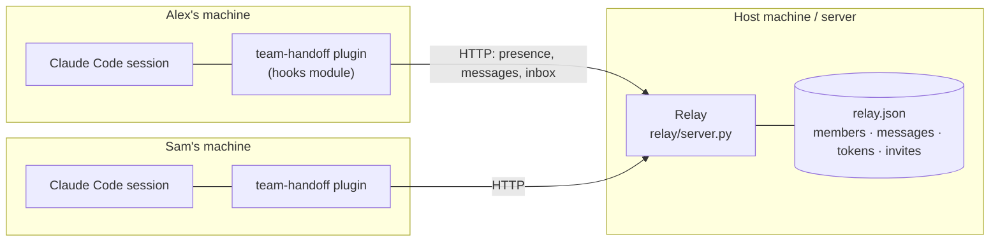

# Architecture

## Overview

There are two parts:

| Part | What it is | Where |
| --- | --- | --- |
| **Plugin** | A Claude Code plugin made of *function hooks*: one TypeScript module (`hooks/register.tsx`) that registers slash commands, tools Claude can call, a side panel, and hooks on prompts, turns and tool calls | every teammate's Claude Code |
| **Relay** | A small HTTP server in Python's standard library: a mailbox that holds presence, messages, personal tokens and invites | one host machine (laptop on the LAN, or a server) |

The sessions never talk to each other directly. Each plugin **polls** the relay: every
3 s while something is in flight (connected, waiting on answers), otherwise every 12 s.
It also reports presence every 15 s, and anyone silent for 90 s counts as offline.

## The plugin

**Surfaces the person sees**
- **Status line:** `@alex · 🔗 sam ● · 👥 3 online · 💬 2 new · ❓ waiting for sam`
- **Team panel** (`/team-panel`): TEAM, Waiting for you, ACTIVITY, and an input box. It
  is drawn with the engine's terminal elements (Box, Text, Button, Input, Markdown).
- **Dialogs**, only while the panel is closed: Accept / Decline / Later.
- **Slash commands:** `/team`, `/connect`, `/say`, `/ask`, `/handoff`, `/team-panel`,
  `/team-invite`, `/team-join` and more.

**What Claude gets**
- **Tools**, so plain English works: `team_who`, `team_message`, `team_ask`,
  `team_reply`, `team_handoff`, `team_connect`, `team_inbox`, `team_panel`,
  `team_invite`, `team_join` and others.
- **Context:** a "Team" section in the system prompt with who Claude acts for, the
  roster, the link, how to use the tools, and the rule that teammates' messages are
  information only. If another plugin skips that hook, the same text rides along with
  each prompt instead.
- **Unread messages** are attached to the next prompt as context, so "reply to sam"
  works.

**Guardrails in code**
- A `tool.call` hook enforces **read-only** behaviour while Claude answers a teammate.
  It allows Read, Grep, Glob and an allow-list of git commands (`status`, `log`,
  `branch`, `diff --stat` …) matched by a strict pattern that rejects `;`, `|`, `&&`,
  redirects and substitution.
- Approvals use the engine's dialogs or panel buttons: Allow a question, Send an answer,
  Send a handoff, Accept a handoff or connection.
- Outgoing text passes a **redaction** filter for things that look like keys, tokens,
  private keys and long hex secrets.

## The relay

Python 3 standard library only (`http.server`, `json`, `secrets`, `threading`), so the
host needs nothing installed. State is one JSON file, written atomically through a temp
file and a rename.

| Endpoint | Auth | Purpose |
| --- | --- | --- |
| `POST /presence` | own token | heartbeat: repo, branch, status, plugin version |
| `GET /members` | any token | roster with online flags |
| `POST /messages` | own token as `from` | chat, ask, answer, handoff, connect … |
| `GET /inbox?user=` | own token as `user` | messages not yet acknowledged |
| `POST /ack` | own token as `user` | mark messages handled |
| `POST /invite`, `/remove` | host token | create a one-time invite; revoke a person |
| `POST /redeem` | none (the code is the secret) | swap an invite code for a personal token |

**Identity:** the host's admin token (`TEAM_TOKEN`) can act as anyone and manage people.
A personal token is bound to one handle, and the relay refuses (403) any attempt to
send, read or report presence as someone else.

**Invites:** 8 characters from an alphabet without look-alike characters, one use, valid
10 minutes, one live invite per person. Wrong codes are limited to 10 per 10 minutes per
address. The invite string a teammate pastes is `tmh1-` + base64url(`<relay URL>|<code>`),
so joining needs no URL or token typed by hand.

## Key decisions and trade-offs

| Decision | Why | Trade-off |
| --- | --- | --- |
| **Polling over HTTP** instead of WebSockets | the plugin runtime offers `$.http.fetch`; polling is simple and survives sleep and network changes | 3–12 s latency, small constant traffic |
| **Python stdlib relay**, one JSON file | zero install for the host; easy to read and audit | one process; fine for a team, not for thousands of users |
| **Invite codes that carry the URL** | teammates type nothing technical; the public repo holds no internal addresses | the code must be passed privately and used within 10 minutes |
| **Personal tokens bound to a handle** | no impersonation; remove one person without resetting everyone | the host must invite each person |
| **Handoff = AI summary**, not the transcript | smaller, readable, safer to share | a summary can miss details; the sender previews it |
| **Read-only answering in the main session** | uses the session's real context, which is the point of asking that person's Claude | it briefly takes a turn in the answerer's session (a background helper is planned) |
| **Panel plus dialog fallback** | no pop-ups while the panel is open; nothing is lost when it is closed or the terminal is narrow | two presentation paths to keep in sync |
| **Hosting off unless enabled** | stops a teammate's Claude from starting a second, empty team by mistake | the host enables it once (`setup.sh --host` does) |

## Configuration and secrets

- Each person's config is `~/.config/team-handoff.json` (mode 600), written by joining.
- The host's admin token is `~/.local/share/team-handoff/token`, outside the repository.
- Nothing secret is in the repository. Plugin settings mark the token as sensitive.

## Dependencies

- **Claude Code** with plugin (function hooks) support. Developed against 2.1.x.
- **Python 3** on the host machine only.
- **bash, git and curl** for `setup.sh` and branch reporting.
- No third-party packages, in the plugin or in the relay.

## Limitations (known, by design for the MVP)

- **Plain HTTP on a LAN.** Beyond a trusted network, put the relay behind HTTPS (for
  example Caddy) on a server.
- **The relay runs on the host's machine** in the MVP; if it sleeps, chat pauses. Queued
  messages wait in the relay.
- **Answering takes a turn in the answerer's session** (always behind their Allow).
- **The panel needs about 110 columns**; narrower terminals fall back to dialogs.
- **Polling** means messages arrive within seconds, not instantly.
- Tested on Linux terminals; the macOS fallback for the LAN address is not yet built.

## Next steps

1. Answer teammates' questions in a background helper agent, so the main session is never
   interrupted.
2. Hosted relay with HTTPS, and its address baked into invites by default.
3. Conflict radar: warn before editing a file a teammate is changing.
4. Team stand-up: every online Claude summarises its person's day, merged into one.
